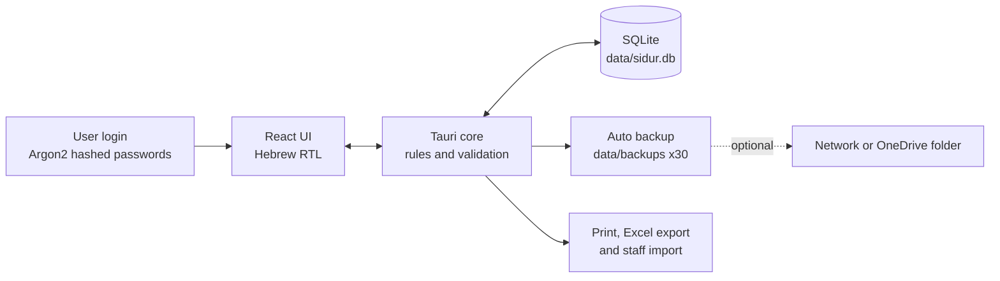
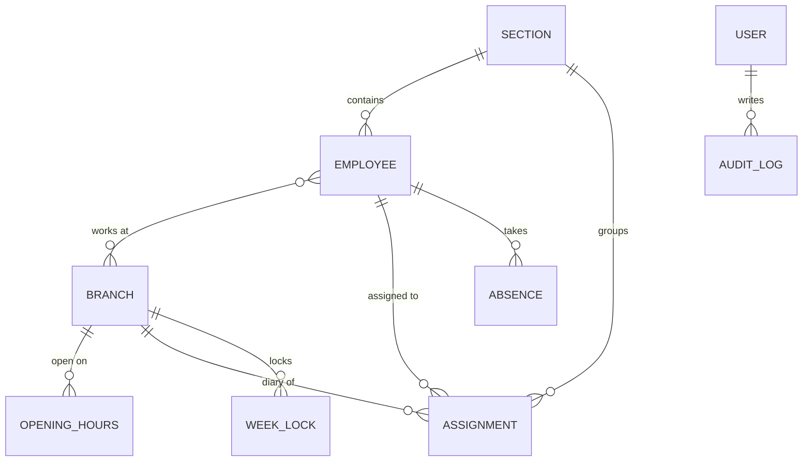

<p align="center">
  
</p>

<h1 align="center">Sidur · סידור</h1>

<p align="center">
  <b>A portable, Hebrew-first shift scheduler for multi-branch businesses.</b><br>
  One diary per branch, separate sections for front desk and professional staff, week locking and live hour tracking.
</p>

<p align="center">
  <a href="https://galasulin.github.io/shift-scheduler-showcase/demo/"></a>
  
  
  
</p>

---

## The problem

A service business with five branches ran its staff schedule in separate Excel files. Hours were never fixed: they change with the season, the people and the week. Nobody could see who covers which hours, how many hours each employee was getting, and planning ahead meant copy-paste errors.

## The solution

**Sidur** replaces those spreadsheets with one clean, Hebrew-first desktop app that runs from a single folder on one PC. No server, no cloud, no installation.

| | |
|---|---|
| **Diary per branch** | A tab for every branch, with a *front desk* section and a *professional staff* section. |
| **No fixed shifts** | Every assignment is a person with their own hours that day (07:30–14:00, 16:00–21:00). One-click presets and per-employee regular hours save typing, but never lock you in. |
| **Coverage at a glance** | A coverage strip under every day shows which opening hours are covered and which are left without anyone. Informational, no nagging rules. |
| **Opening hours per branch and day** | Each branch has its own opening hours per weekday, and any date can get a one-off exception (late Wednesday, holiday eve). Changes apply from a chosen date and never rewrite past weeks. |
| **Change a day from the diary** | Click a day's header to change its hours or close the branch for that date only, right from the weekly diary. The regular weekly hours stay as they are, and one click goes back to them. |
| **Day, week and month** | One switch between a day across all branches (who works where, move an assignment to another branch), a week per branch and a month per branch (people and hours per day, special days, unscheduled days, locked weeks). |
| **Plan ahead, then lock** | Schedule weeks and months in advance. Copy last week as a starting point, adjust the hours, lock the week. |
| **Hours at a glance** | Every employee has a live counter against a weekly target. Going over turns red. |
| **Smart warnings** | Double booking across branches is blocked. Absences, unavailable days, overtime and short rest periods raise warnings before you assign. |
| **Absences and availability** | Vacation, sickness, reserve duty and other, with their own screen and a row in the diary. Optional weekdays an employee is not available. Copying last week skips people who are away. |
| **Reports** | Filter by dates, branches and section: hours per employee against the target for the period, hours per branch per week, coverage gaps and absences. Print or export. |
| **Excel in and out** | Export the week, the month and the reports as right-to-left sheets. Import existing staff from a template, with a preview of every error before anything is saved. |
| **Change log** | Every change is logged with the user, the time and the values before and after, and the admin can filter and read it. |
| **Users and roles** | Personal username and password for everyone. Admin, editor (own branches only) and view-only. |
| **Portable and safe** | One `Sidur.exe`, one SQLite file, automatic backup on every launch (last 30 copies). Printing opens on the default printer of whoever is signed in to Windows. |

---

## Screens

<table>
  <tr>
    <td colspan="2"><br><sub><b>Weekly schedule</b> · the main screen. Branch tabs, opening hours per day, each person with their own hours, coverage strip, hour counters, absences row.</sub></td>
  </tr>
  <tr>
    <td width="50%"><br><sub><b>Assign dialog</b> · pick a person, then hours (preset or free); overlaps, absences and overtime flagged before you save.</sub></td>
    <td width="50%"><br><sub><b>Month view</b> · people and hours per day, special days, unscheduled days and locked weeks.</sub></td>
  </tr>
  <tr>
    <td width="50%"><br><sub><b>Employees</b> · multi-branch staff, weekly targets, availability.</sub></td>
    <td width="50%"><br><sub><b>Settings</b> · users and roles, opening hours and presets, backups.</sub></td>
  </tr>
  <tr>
    <td width="50%"><br><sub><b>Login</b> · personal credentials, password reveal.</sub></td>
    <td width="50%"><br><sub><b>Lockout and first login</b> · 5 failed attempts lock for 5 minutes; new password on first login.</sub></td>
  </tr>
</table>

> All names, branches and numbers in the screens are fictional sample data.

---

## Try it

**[Open the interactive demo →](https://galasulin.github.io/shift-scheduler-showcase/demo/)**

Switch branches (each one has different opening hours), move between weeks, click "+ שיבוץ" to add a person with any hours, hover an assignment to remove it, copy last week and lock it. Hour counters, coverage strips and KPIs update live. Everything is stored only in your browser.

The demo is the clickable prototype from the design stage. The production app (v1.1.0, Windows) is private.

---

## How it works



**Data model**



**Portable folder**

```text
Sidur\
├── Sidur.exe
└── data\
    ├── sidur.db
    ├── backups\
    └── exports\
```

| Layer | Choice | Why |
|---|---|---|
| Shell | Tauri | Small native Windows window, no browser, no open port |
| UI | React + Tailwind | Modern, fully right-to-left Hebrew interface |
| Data | SQLite | One file, no database server, trivial to back up |
| Security | Argon2, roles, lockout, idle logout, audit log | Several people can share one PC safely |
| Output | Print + XLSX | Print a day, week, month or report; Excel export, and staff import from Excel |

---

## Warning rules

| Situation | Behaviour |
|---|---|
| Overlapping hours for the same employee (any branch) | Blocked |
| Employee is on leave, sick or on reserve duty | Warning + confirm |
| Weekly hour target exceeded | Yellow warning, red counter |
| Hours outside the branch's opening hours | Yellow warning |
| Employee assigned outside their branches | Yellow warning |
| Employee marked as not available that weekday | Yellow warning |
| Less than 11 hours rest between two assignments | Yellow warning |
| Editing a locked week | Blocked, unlock is admin only and logged |

---

## Roadmap

- [x] Research of existing tools (Deputy, When I Work, Homebase, open-source schedulers)
- [x] Product spec, data model and warning rules
- [x] UI design, review pack and interactive prototype
- [x] **Phase 1** (v1.0) · Login and users, branches, sections, employees, opening hours and presets, changing a day's hours from the diary, weekly diary with per-person hours, coverage strip, hour counters, week locking, copy previous week, auto backup, PDF print
- [x] **Phase 2** (v1.1) · Absences, unavailable weekdays, warnings
- [x] **Phase 3** (v1.1) · Day view across branches, month view, reports with filters, Excel export
- [x] **Phase 4** (v1.1) · Excel import of existing staff, full change log

**v1.1.0 (October 2026): every phase is built.** Acceptance run on the real `Sidur.exe` from a clean folder: setup, roles, lockout, overlaps, locked weeks, absences, month and day views, reports, Excel export and import, change log, print to PDF, restart, moving the folder and idle sign-out.

---

## In this repository

| Path | What it is |
|---|---|
| [`demo/index.html`](demo/index.html) | Single-file interactive prototype (no build step) |
| [`docs/spec-he.md`](docs/spec-he.md) | Full product specification in Hebrew |
| [`docs/review-pack.pdf`](docs/review-pack.pdf) | 12-page review pack with every screen, a QA checklist and sign-off form |
| [`assets/screens/`](assets/screens) | Screen designs |

---

## בעברית

**סידור** היא מערכת ניידת לניהול משמרות בעסקים עם כמה סניפים. יומן לכל סניף, רובריקה של צוות שירות ורובריקה של צוות מקצועי, כל עובד משובץ בשעות שלו בלי משמרות קבועות, פס כיסוי, שיבוץ שבועות קדימה, נעילת שבוע, מונה שעות לכל עובד מול יעד, ואזהרות על כפילויות, היעדרויות וחריגות. רצה מתיקייה אחת על מחשב Windows, בלי התקנה ובלי שרת, עם כניסה אישית לכל משתמש וגיבוי אוטומטי.

**גרסה 1.1.0 (אוקטובר 2026): כל השלבים נבנו.** תצוגת יום לכל הסניפים, שבוע וחודש, היעדרויות וימים לא זמינים, דוחות עם סינון, ייצוא לאקסל, ייבוא עובדים מאקסל ויומן שינויים. ההדפסה נפתחת על מדפסת ברירת המחדל של המשתמש.

האפיון המלא: [`docs/spec-he.md`](docs/spec-he.md) · מסמך הבדיקה: [`docs/review-pack.pdf`](docs/review-pack.pdf)

---

<table>
  <tr>
    <td width="96" align="center"></td>
    <td>
      <b>Gal Asulin</b> · IT Manager · The King<br>
      Product spec, UX design and development.<br>
      <a href="https://github.com/galasulin">github.com/galasulin</a>
    </td>
  </tr>
</table>

<sub>© 2026 Gal Asulin. Showcase project. Source code for the production app is not included. See <a href="LICENSE">LICENSE</a>.</sub>
