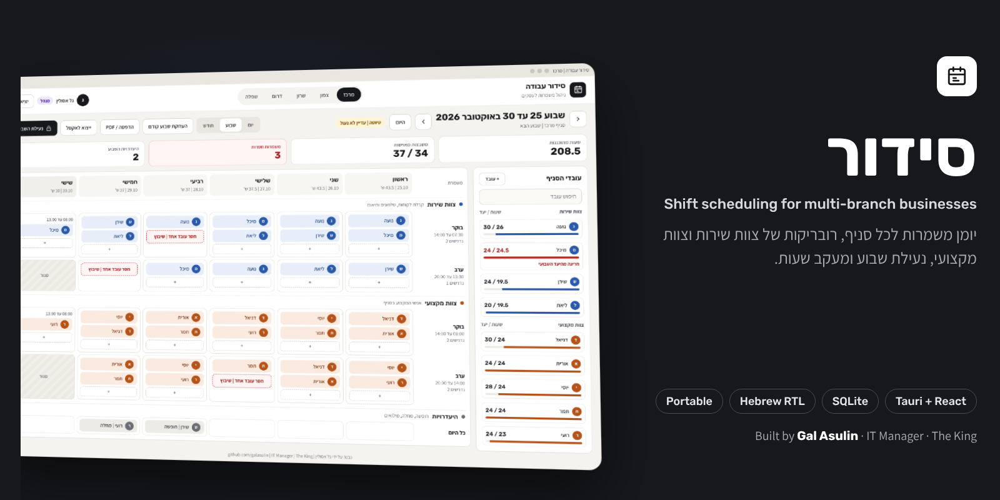
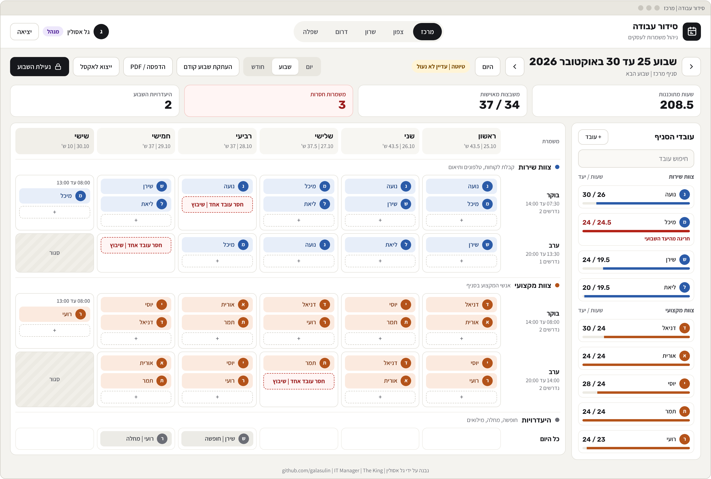
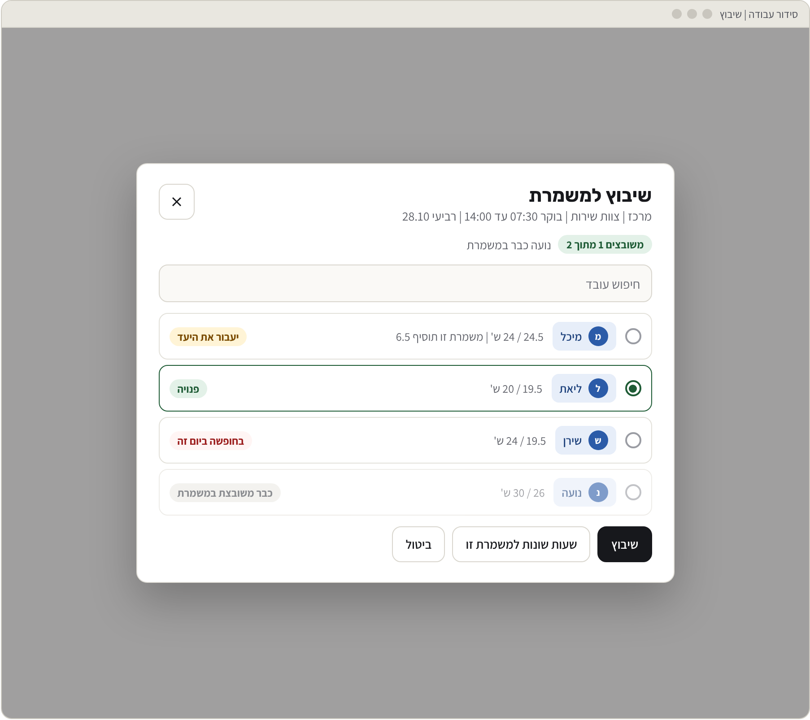
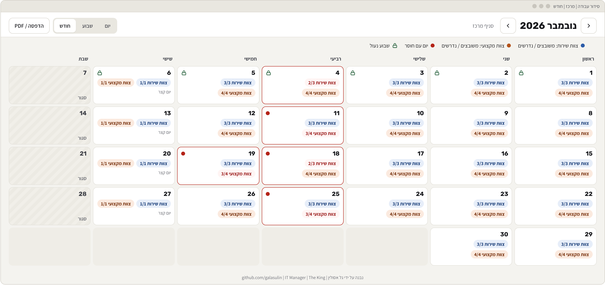
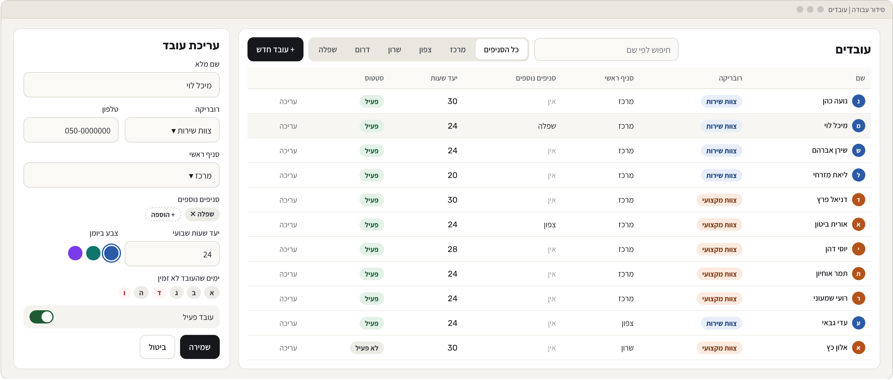
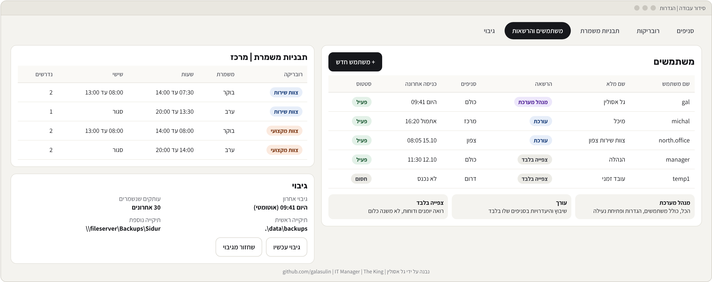
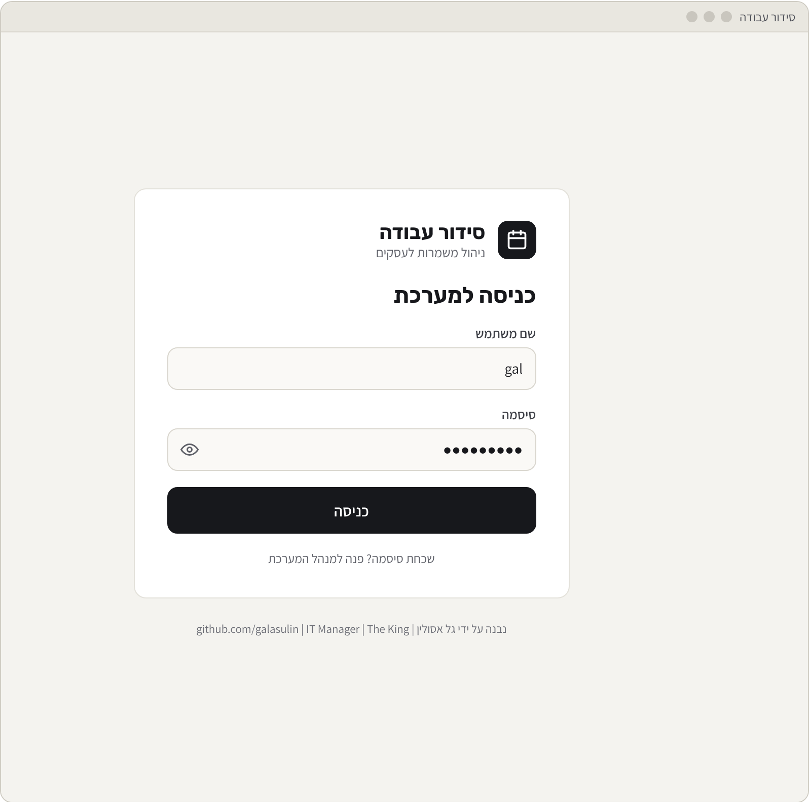
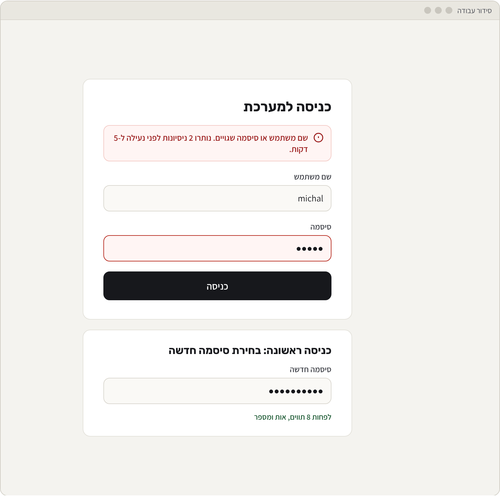
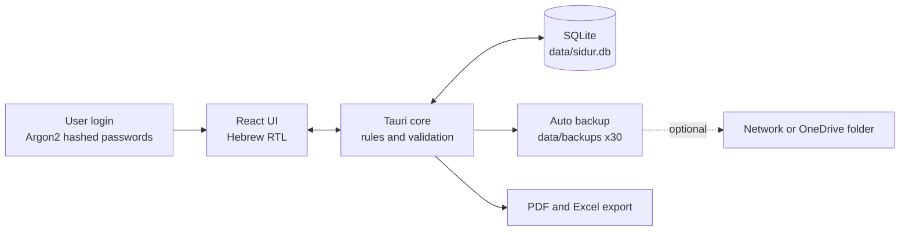
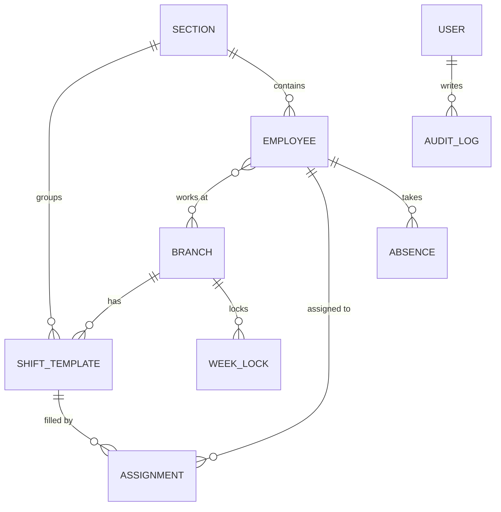

<p align="center">
  
</p>

<h1 align="center">Sidur · סידור</h1>

<p align="center">
  <b>A portable, Hebrew-first shift scheduler for multi-branch businesses.</b><br>
  One diary per branch, separate sections for front desk and professional staff, week locking and live hour tracking.
</p>

<p align="center">
  <a href="https://galasulin.github.io/shift-scheduler-showcase/demo/"></a>
  
  
  
</p>

---

## The problem

A service business with five branches ran its staff schedule in separate Excel files. Gaps were hard to spot, nobody could see how many hours each employee was getting, and planning more than a week ahead meant copy-paste errors.

## The solution

**Sidur** replaces those spreadsheets with one clean, Hebrew-first desktop app that runs from a single folder on one PC. No server, no cloud, no installation.

| | |
|---|---|
| **Diary per branch** | A tab for every branch. Each branch has a *front desk* section and a *professional staff* section, with morning and evening shifts. |
| **Plan ahead, then lock** | Schedule weeks and months in advance. Copy last week as a starting point, fill the red gaps, lock the week. |
| **Hours at a glance** | Every employee has a live counter against a weekly target. Going over turns red. |
| **Smart warnings** | Double booking across branches is blocked. Absences, overtime and short rest periods raise warnings before you assign. |
| **Users and roles** | Personal username and password for everyone. Admin, editor (own branches only) and view-only. |
| **Portable and safe** | One `Sidur.exe`, one SQLite file, automatic backup on every launch (last 30 copies). |

---

## Screens

<table>
  <tr>
    <td colspan="2"><br><sub><b>Weekly schedule</b> · the main screen. Branch tabs, KPIs, staff hour counters, gaps marked in red, absences row.</sub></td>
  </tr>
  <tr>
    <td width="50%"><br><sub><b>Assign dialog</b> · who is free, who is absent, who will go over target.</sub></td>
    <td width="50%"><br><sub><b>Month view</b> · staffed vs. required per day, gaps and locked weeks.</sub></td>
  </tr>
  <tr>
    <td width="50%"><br><sub><b>Employees</b> · multi-branch staff, weekly targets, availability.</sub></td>
    <td width="50%"><br><sub><b>Settings</b> · users and roles, shift templates, backups.</sub></td>
  </tr>
  <tr>
    <td width="50%"><br><sub><b>Login</b> · personal credentials, password reveal.</sub></td>
    <td width="50%"><br><sub><b>Lockout and first login</b> · 5 failed attempts lock for 5 minutes; new password on first login.</sub></td>
  </tr>
</table>

> All names, branches and numbers in the screens are fictional sample data.

---

## Try it

**[Open the interactive demo →](https://galasulin.github.io/shift-scheduler-showcase/demo/)**

Switch branches, move between weeks, click a red gap to assign someone, remove a shift, copy last week and lock it. Hour counters, gaps and KPIs update live. Everything is stored only in your browser.

---

## How it works



**Data model**



**Portable folder**

```text
Sidur\
├── Sidur.exe
└── data\
    ├── sidur.db
    └── backups\
```

| Layer | Choice | Why |
|---|---|---|
| Shell | Tauri | Small native Windows window, no browser, no open port |
| UI | React + Tailwind | Modern, fully right-to-left Hebrew interface |
| Data | SQLite | One file, no database server, trivial to back up |
| Security | Argon2, roles, lockout, idle logout, audit log | Several people can share one PC safely |
| Output | PDF + XLSX | Print a week for the branch wall, export for reports |

---

## Warning rules

| Situation | Behaviour |
|---|---|
| Same employee in two overlapping shifts (any branch) | Blocked |
| Employee is on leave, sick or on reserve duty | Warning + confirm |
| Weekly hour target exceeded | Yellow warning, red counter |
| Shift has fewer people than required | Red dashed cell + KPI count |
| Employee assigned outside their branches | Yellow warning |
| Less than 11 hours rest between shifts | Yellow warning |
| Editing a locked week | Blocked, unlock is admin only and logged |

---

## Roadmap

- [x] Research of existing tools (Deputy, When I Work, Homebase, open-source schedulers)
- [x] Product spec, data model and warning rules
- [x] UI design, review pack and interactive prototype
- [ ] **Phase 1** · Login and users, branches, sections, employees, shift templates, weekly diary, hour counters, PDF print
- [ ] **Phase 2** · Absences, warnings, week locking, copy previous week, auto backup
- [ ] **Phase 3** · Day view across branches, month view, reports, Excel export
- [ ] **Phase 4** · Excel import of existing staff, full audit log

---

## In this repository

| Path | What it is |
|---|---|
| [`demo/index.html`](demo/index.html) | Single-file interactive prototype (no build step) |
| [`docs/spec-he.md`](docs/spec-he.md) | Full product specification in Hebrew |
| [`docs/review-pack.pdf`](docs/review-pack.pdf) | 12-page review pack with every screen, a QA checklist and sign-off form |
| [`assets/screens/`](assets/screens) | Screen designs |

---

## בעברית

**סידור** היא מערכת ניידת לניהול משמרות בעסקים עם כמה סניפים. יומן לכל סניף, רובריקה של צוות שירות ורובריקה של צוות מקצועי, שיבוץ שבועות קדימה, נעילת שבוע, מונה שעות לכל עובד מול יעד, ואזהרות על כפילויות, היעדרויות וחריגות. רצה מתיקייה אחת על מחשב Windows, בלי התקנה ובלי שרת, עם כניסה אישית לכל משתמש וגיבוי אוטומטי.

האפיון המלא: [`docs/spec-he.md`](docs/spec-he.md) · מסמך הבדיקה: [`docs/review-pack.pdf`](docs/review-pack.pdf)

---

<table>
  <tr>
    <td width="96" align="center"></td>
    <td>
      <b>Gal Asulin</b> · IT Manager · The King<br>
      Product spec, UX design and development.<br>
      <a href="https://github.com/galasulin">github.com/galasulin</a>
    </td>
  </tr>
</table>

<sub>© 2026 Gal Asulin. Showcase project. Source code for the production app is not included. See <a href="LICENSE">LICENSE</a>.</sub>
