<p align="center"><a href="https://galasulin.github.io/shift-scheduler-showcase/demo/">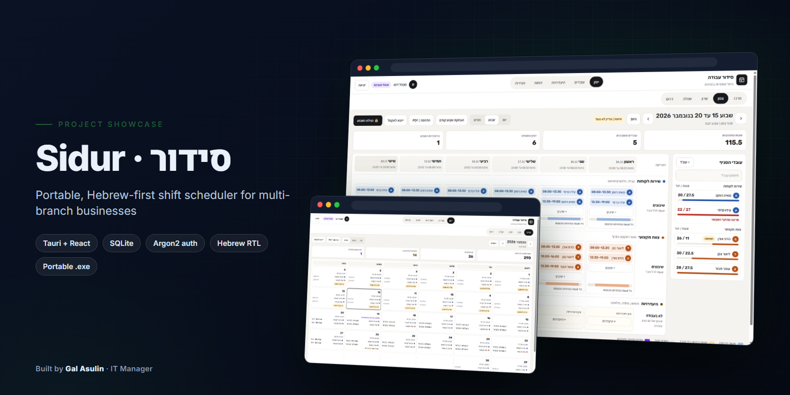</a></p>

<div align="center">

# Sidur · סידור

**A portable, Hebrew-first shift scheduler for multi-branch businesses.**<br>
One diary per branch, separate sections for front desk and professional staff, week locking and live hour tracking.

🇬🇧 [English](README.md) · 🇮🇱 [עברית](README.he.md)

<a href="https://galasulin.github.io/shift-scheduler-showcase/demo/"></a>


[**Live demo**](https://galasulin.github.io/shift-scheduler-showcase/demo/) · [Screens](#screens) · [Architecture](#architecture) · [Tech](#technical-parameters)

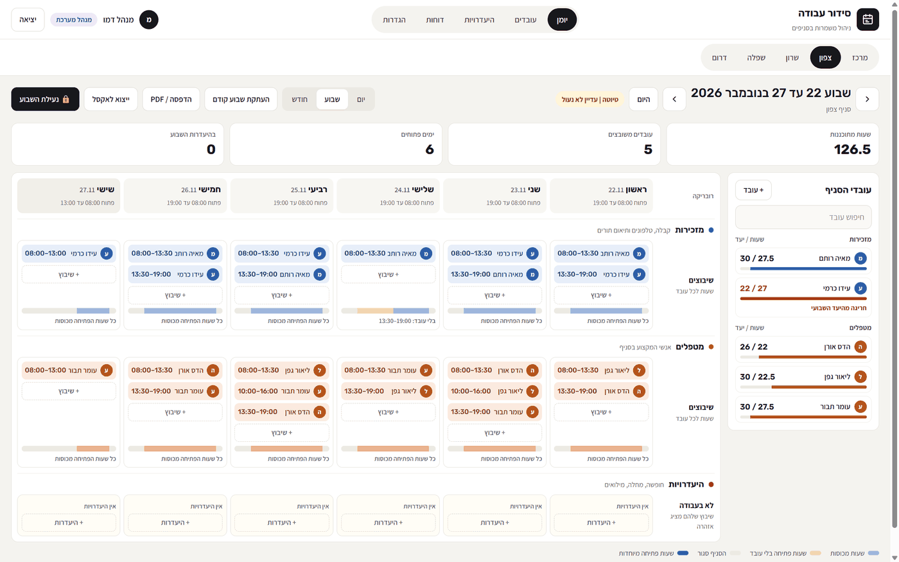<br>
<sub>Assigning a shift in Sidur 1.1.0 itself, running on an invented dataset</sub>

</div>

---

## At a glance

| | |
|---|---|
| **Type** | Portable Windows desktop app for staff scheduling |
| **Status** | v1.1.0 (October 2026), all four phases built and acceptance-tested |
| **Stack** | Tauri · React + Tailwind · SQLite · Argon2 |
| **My role** | Product spec, UX design and development |
| **Live demo** | [Interactive prototype](https://galasulin.github.io/shift-scheduler-showcase/demo/) (design stage, runs in the browser) |
| **Languages** | Hebrew, fully right-to-left |

## Screens

Real app screenshots, captured from Sidur 1.1.0 running on an invented dataset: 5 branches (מרכז, צפון, שרון, שפלה, דרום), 25 invented employees, two weeks of shifts. The app's source stays private.

<table>
  <tr>
    <td width="33%"><a href="assets/real-app/01-week-view.png">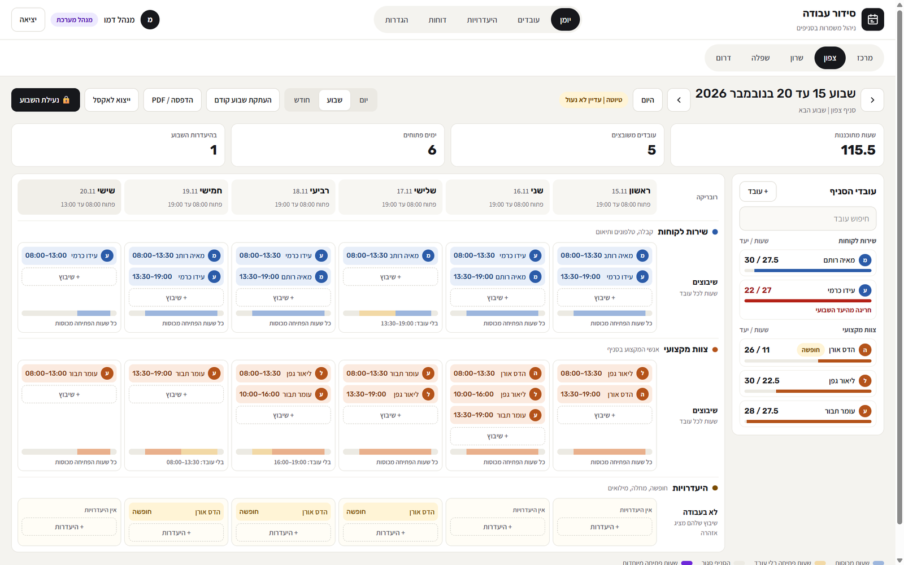</a><br><sub><b>Week</b> · coverage gap, an employee over target in red, absences row</sub></td>
    <td width="33%"><a href="assets/real-app/02-day-view-all-branches.png">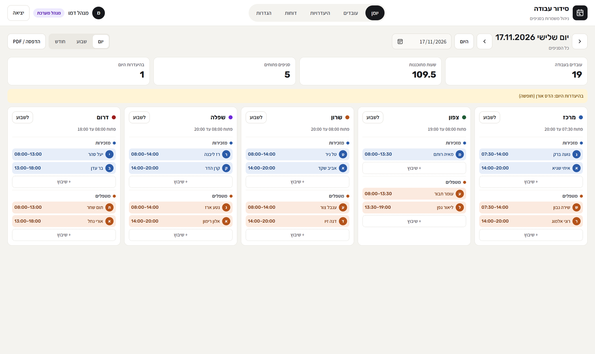</a><br><sub><b>Day</b> · one day across all five branches</sub></td>
    <td width="33%"><a href="assets/real-app/03-month-view.png">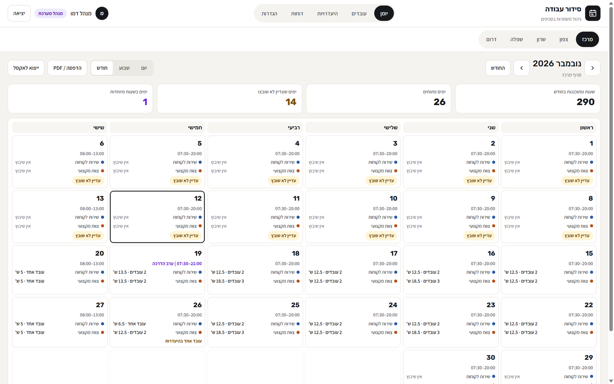</a><br><sub><b>Month</b> · a special-hours day in purple</sub></td>
  </tr>
  <tr>
    <td width="33%"><a href="assets/real-app/04-assign-shift-dialog.png">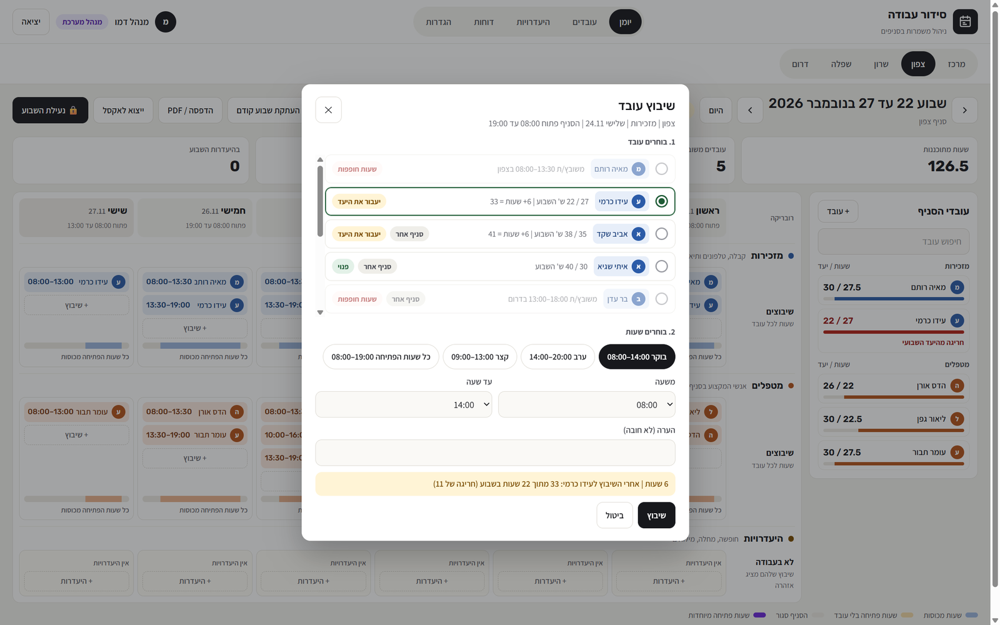</a><br><sub><b>Assign</b> · free, overlapping, other branch, over target</sub></td>
    <td width="33%"><a href="assets/real-app/05-employees.png">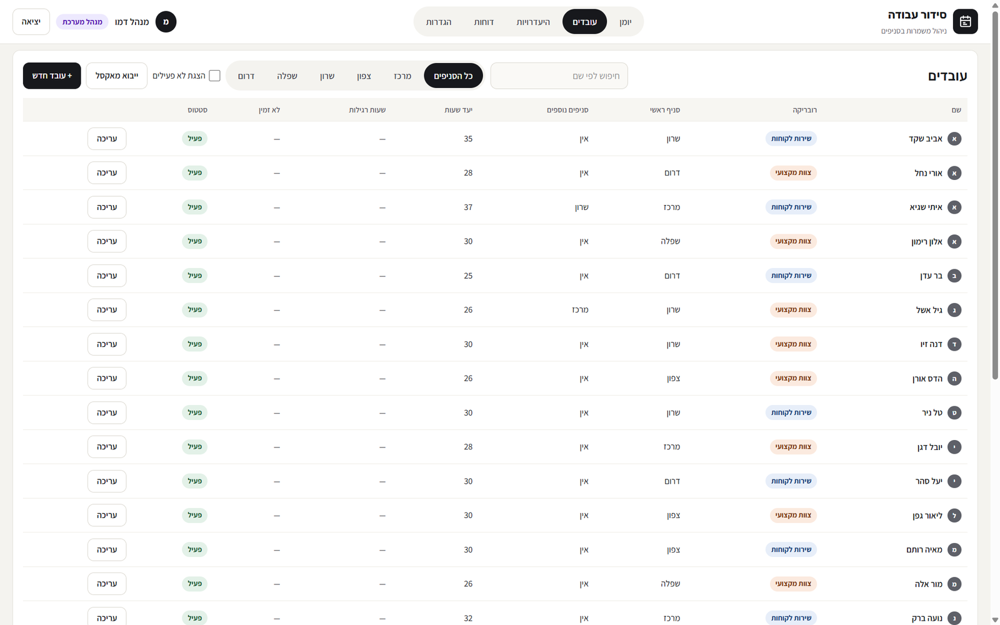</a><br><sub><b>Employees</b> · section, branches, weekly target</sub></td>
    <td width="33%"><a href="assets/real-app/06-absences.png">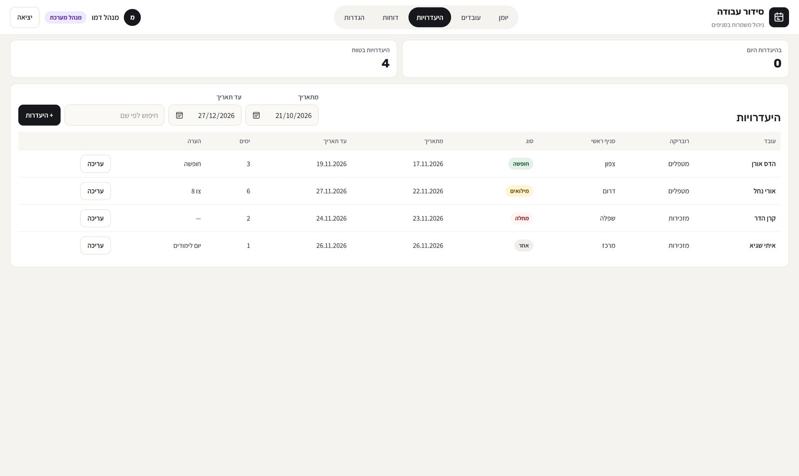</a><br><sub><b>Absences</b> · vacation, sick, reserve duty</sub></td>
  </tr>
  <tr>
    <td width="33%"><a href="assets/real-app/07-reports.png">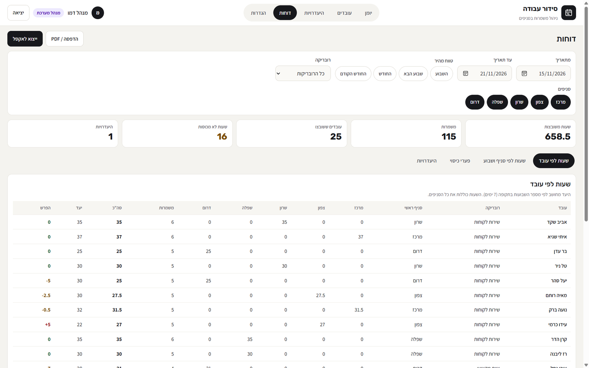</a><br><sub><b>Reports</b> · hours vs. target, uncovered hours</sub></td>
    <td width="33%"><a href="assets/real-app/08-settings-opening-hours.png">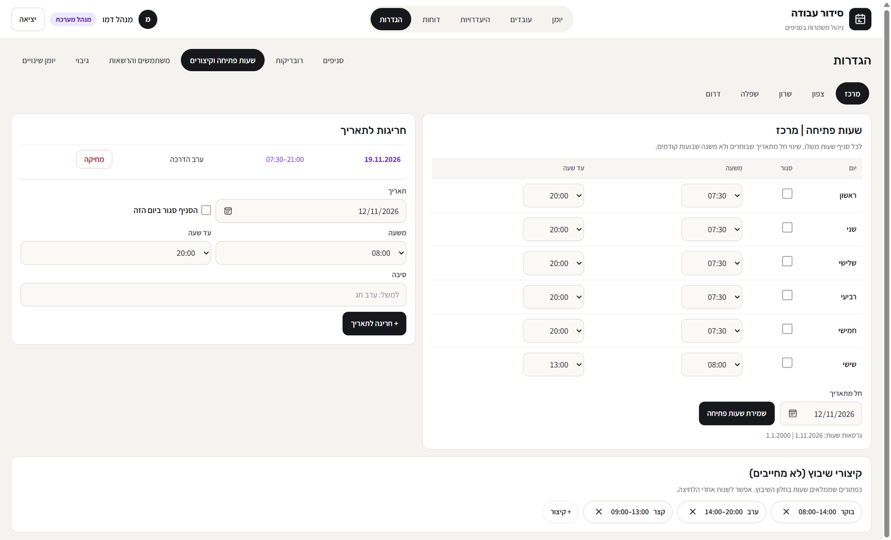</a><br><sub><b>Settings</b> · opening hours, date exception, presets</sub></td>
    <td width="33%"><a href="assets/demo-preview.png">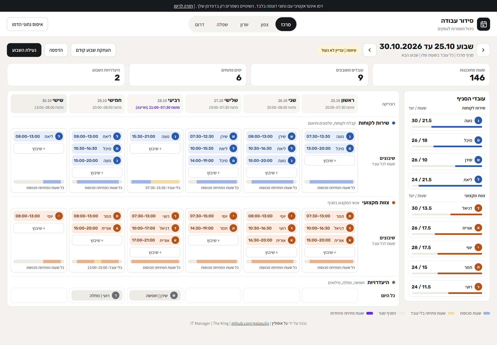</a><br><sub><b>Prototype</b> · the clickable design-stage demo</sub></td>
  </tr>
</table>

<details>
<summary><b>Design-stage screens</b> (from the review pack)</summary>

<table>
  <tr>
    <td width="50%"><a href="assets/screens/01-login-a.png">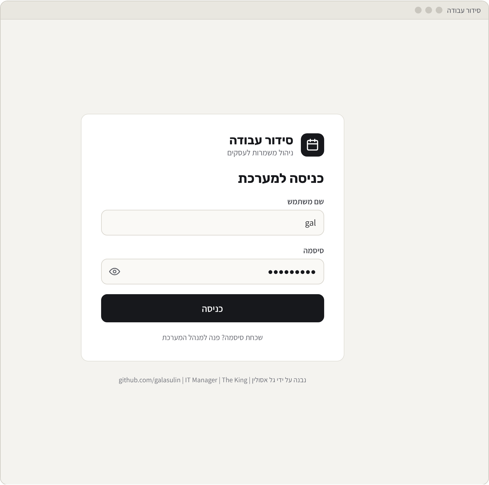</a><br><sub><b>Login</b> · personal credentials</sub></td>
    <td width="50%"><a href="assets/screens/01-login-b.png">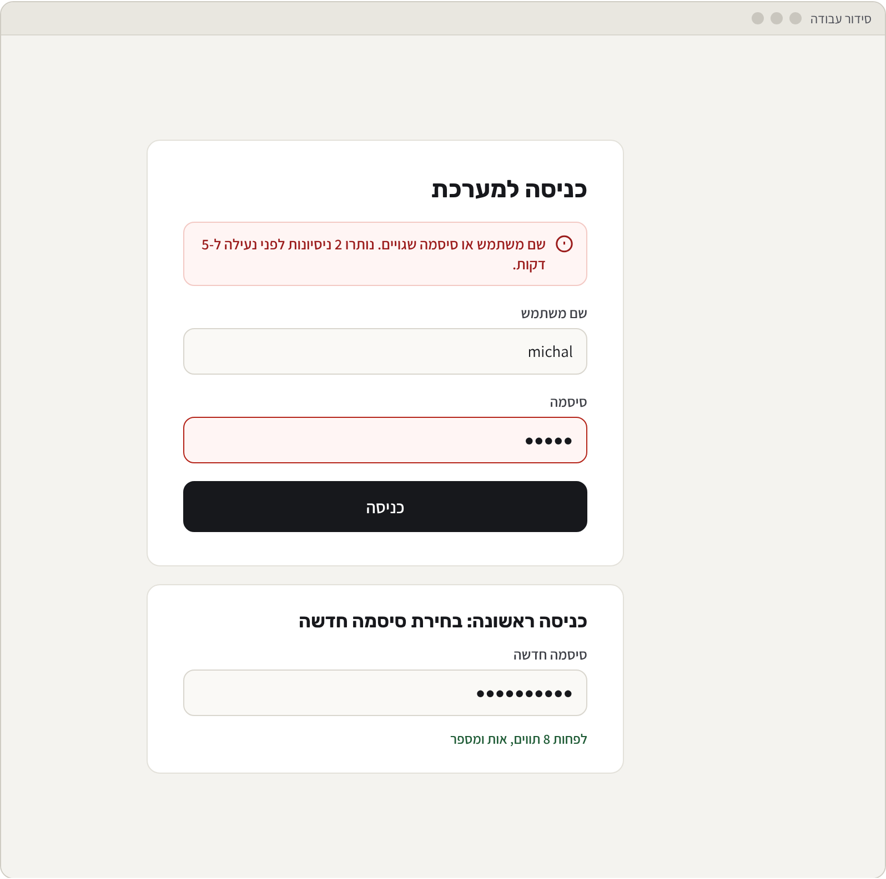</a><br><sub><b>Lockout and first login</b> · 5 attempts, 5 minutes</sub></td>
  </tr>
</table>

</details>

> All names, branches and numbers in the screens are fictional sample data.

## What it is

**The problem.** A service business with five branches ran its staff schedule in separate Excel files. Hours were never fixed: they change with the season, the people and the week. Nobody could see who covers which hours or how many hours each employee was getting, and planning ahead meant copy-paste errors.

**The solution.** Sidur replaces those spreadsheets with one Hebrew-first desktop app that runs from a single folder on one PC. No server, no cloud, no installation. Each assignment is a person with their own hours that day, a coverage strip shows what is left uncovered, and a finished week is locked.

## Key capabilities

| | |
|---|---|
| **Diary per branch** | A tab for every branch, with a *front desk* section and a *professional staff* section. |
| **No fixed shifts** | Every assignment is a person with their own hours that day (07:30–14:00, 16:00–21:00). One-click presets and per-employee regular hours save typing, but never lock you in. |
| **Coverage at a glance** | A coverage strip under every day shows which opening hours are covered and which are left without anyone. Informational, no nagging rules. |
| **Opening hours per branch and day** | Each branch has its own opening hours per weekday, and any date can get a one-off exception (late Wednesday, holiday eve). Changes apply from a chosen date and never rewrite past weeks. |
| **Change a day from the diary** | Click a day's header to change its hours or close the branch for that date only. The regular weekly hours stay as they are, and one click goes back to them. |
| **Day, week and month** | A day across all branches (who works where, move an assignment to another branch), a week per branch and a month per branch (people and hours per day, special days, unscheduled days, locked weeks). |
| **Plan ahead, then lock** | Schedule weeks and months in advance. Copy last week as a starting point, adjust the hours, lock the week. |
| **Hours at a glance** | Every employee has a live counter against a weekly target. Going over turns red. |
| **Smart warnings** | Double booking across branches is blocked. Absences, unavailable days, overtime and short rest periods raise warnings before you assign. |
| **Absences and availability** | Vacation, sickness, reserve duty and other, with their own screen and a row in the diary. Optional weekdays an employee is not available. Copying last week skips people who are away. |
| **Reports** | Filter by dates, branches and section: hours per employee against the target, hours per branch per week, coverage gaps and absences. Print or export. |
| **Excel in and out** | Export the week, the month and the reports as right-to-left sheets. Import existing staff from a template, with a preview of every error before anything is saved. |
| **Change log** | Every change is logged with the user, the time and the values before and after; the admin can filter and read it. |
| **Users and roles** | Personal username and password for everyone. Admin, editor (own branches only) and view-only. |
| **Portable and safe** | One `Sidur.exe`, one SQLite file, automatic backup on every launch (last 30 copies). Printing opens on the default printer of whoever is signed in to Windows. |

## Architecture

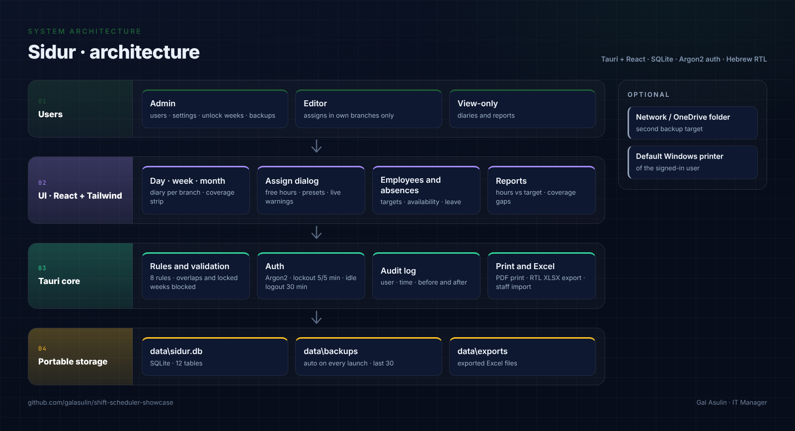

Sidur is a Tauri desktop app: a native Windows window hosts a React + Tailwind interface written fully right-to-left. All rules and validation (overlaps, locked weeks, roles) run in the Tauri core, which owns a single SQLite file in the portable `data\` folder. On every launch the core copies the database into `data\backups` and keeps the last 30 copies; a network or OneDrive folder can be added as a second target. Print, Excel export and staff import go through the same core, and every write is recorded in the audit log.

### Flow

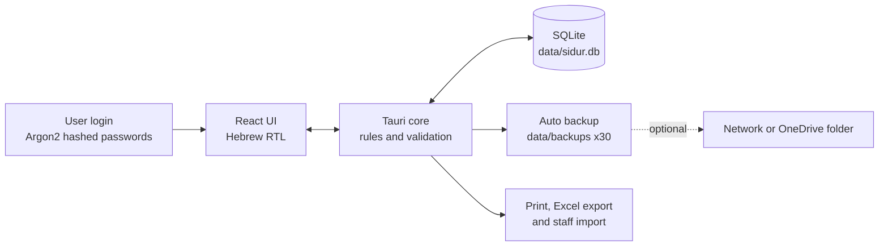

### Data model

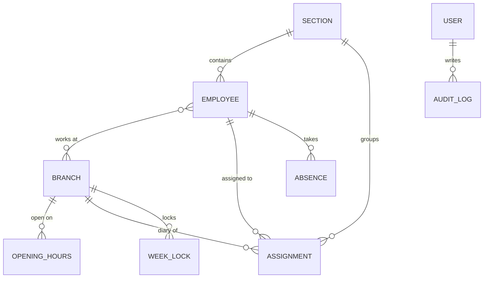

### Portable folder

```text
Sidur\
├── Sidur.exe
└── data\
    ├── sidur.db
    ├── backups\
    └── exports\
```

| Layer | Choice | Why |
|---|---|---|
| Shell | Tauri | Small native Windows window, no browser, no open port |
| UI | React + Tailwind | Modern, fully right-to-left Hebrew interface |
| Data | SQLite | One file, no database server, trivial to back up |
| Security | Argon2, roles, lockout, idle logout, audit log | Several people can share one PC safely |
| Output | Print + XLSX | Print a day, week, month or report; Excel export, and staff import from Excel |

## Technical parameters

| Parameter | Value |
|---|---|
| Platform | Windows 10 and 11, portable: one `Sidur.exe` plus a `data\` folder, no installer, no server, no internet |
| Application stack | Tauri shell, React + Tailwind UI, SQLite storage (`data\sidur.db`) |
| Data model | 12 tables: branch, section, employee, opening hours, opening exception, assignment preset, employee regular hours, assignment, absence, user, week lock, change log |
| Screens | 9: login, weekly diary, assign dialog, month view, day view, employees, absences, reports, settings |
| Roles | 3: admin, editor (assigned branches only), view-only |
| Authentication | Argon2 password hashing; minimum 8 characters with a letter and a digit; forced change at first login; 5 failed attempts lock the account for 5 minutes; automatic sign-out after 30 minutes idle |
| Validation rules | 8 (2 blocking, 6 warnings), listed in [Warning rules](#warning-rules); minimum rest between assignments 11 hours |
| Backups | Automatic on every launch, last 30 copies, optional second folder on the network or OneDrive |
| Output | Print and PDF via the signed-in Windows user's default printer; right-to-left XLSX export of week, month and reports; XLSX staff import with error preview |
| Release | v1.1.0, October 2026; acceptance run on the real `Sidur.exe` from a clean folder |
| Interactive prototype | Single `demo/index.html`, 367 lines (31 KB), vanilla JavaScript, no build step; state in `localStorage` (`sidur-demo-v3`); fonts Assistant and Rubik from Google Fonts |
| Documentation | Hebrew product spec (`docs/spec-he.md`, 124 lines); 12-page review pack PDF |

## Engineering decisions

- **Portable folder instead of a server** → the business runs it on one PC with zero infrastructure and backs it up by copying a folder. Trade-off: the app lives on one PC; people share it with personal logins rather than over a network.
- **Tauri instead of a browser app** → a small native window with no open port and no browser to manage. Trade-off: Windows-only distribution for now.
- **Free hours per person instead of fixed shifts** → hours change with the season, the people and the week, so every assignment carries its own start and end. Presets and regular hours only pre-fill. Trade-off: coverage has to be computed from individual assignments rather than read from a shift table.
- **Coverage shown, not enforced** → the coverage strip is information, not a rule, so managers are never blocked by a gap they already know about. Trade-off: gaps depend on someone looking at the strip or the coverage report.
- **Opening-hour changes apply from a date** → past weeks keep the hours they were planned with. Trade-off: the data model stores effective-from dates and one-off exceptions instead of a single weekly table.
- **Block only what is certainly wrong** → overlaps and edits to locked weeks are blocked; everything else warns and lets the user decide. Trade-off: the change log carries the accountability for overridden warnings.

## Warning rules

| Situation | Behaviour |
|---|---|
| Overlapping hours for the same employee (any branch) | Blocked |
| Employee is on leave, sick or on reserve duty | Warning + confirm |
| Weekly hour target exceeded | Yellow warning, red counter |
| Hours outside the branch's opening hours | Yellow warning |
| Employee assigned outside their branches | Yellow warning |
| Employee marked as not available that weekday | Yellow warning |
| Less than 11 hours rest between two assignments | Yellow warning |
| Editing a locked week | Blocked, unlock is admin only and logged |

## Try it

**[Open the interactive demo →](https://galasulin.github.io/shift-scheduler-showcase/demo/)**

Switch branches (each one has different opening hours), move between weeks, click "+ שיבוץ" to add a person with any hours, hover an assignment to remove it, copy last week and lock it. Hour counters, coverage strips and KPIs update live. Everything is stored only in your browser.

The demo is the clickable prototype from the design stage. The production app (v1.1.0, Windows) is private.

## Roadmap

- [x] Research of existing tools (Deputy, When I Work, Homebase, open-source schedulers)
- [x] Product spec, data model and warning rules
- [x] UI design, review pack and interactive prototype
- [x] **Phase 1** (v1.0) · Login and users, branches, sections, employees, opening hours and presets, changing a day's hours from the diary, weekly diary with per-person hours, coverage strip, hour counters, week locking, copy previous week, auto backup, PDF print
- [x] **Phase 2** (v1.1) · Absences, unavailable weekdays, warnings
- [x] **Phase 3** (v1.1) · Day view across branches, month view, reports with filters, Excel export
- [x] **Phase 4** (v1.1) · Excel import of existing staff, full change log

**v1.1.0 (October 2026): every phase is built.** Acceptance run on the real `Sidur.exe` from a clean folder: setup, roles, lockout, overlaps, locked weeks, absences, month and day views, reports, Excel export and import, change log, print to PDF, restart, moving the folder and idle sign-out.

## Repository layout

```text
shift-scheduler-showcase/
├── README.md · README.he.md
├── LICENSE
├── demo/
│   └── index.html            # single-file interactive prototype (no build step)
├── docs/
│   ├── spec-he.md            # full product specification in Hebrew
│   └── review-pack.pdf       # 12-page review pack: every screen, QA checklist, sign-off form
└── assets/
    ├── banner.png
    ├── demo-preview.png      # prototype screenshot
    ├── real-app/             # 8 screenshots + 1 GIF from Sidur 1.1.0 (demo data)
    └── screens/              # design-stage screens
```

## Privacy & scope

- This repository is a showcase. The production app's source code is private and not included.
- The real-app screenshots come from Sidur 1.1.0 running on an invented dataset. All names, branches and numbers in the screens and documents are fictional sample data.
- The interactive demo stores everything only in the visitor's own browser.

---

<div align="center"><b>Built by <a href="https://github.com/galasulin">Gal Asulin</a>, IT Manager</b></div>

<p align="center"><sub>© 2026 Gal Asulin. Showcase project. Source code for the production app is not included. See <a href="LICENSE">LICENSE</a>.</sub></p>
